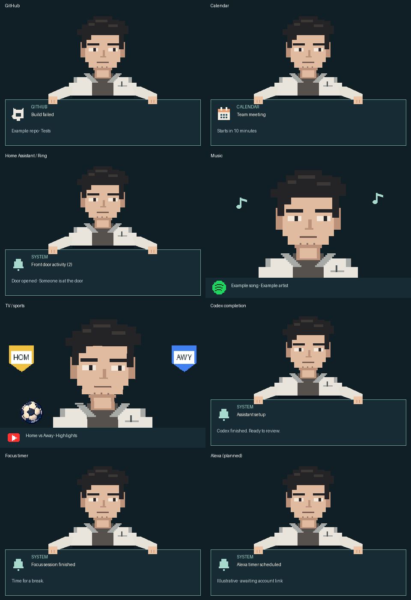

# AI Hardware Lab — OkabeBot

A push-to-talk companion with a talking pixel character and shared dashboard/MCP tools for real hardware. Hold a button, speak, and release. The current deployment runs speech recognition, Qwen conversation and Qwen speech locally on a Mac; Codex remains an optional backend and the repository default for fresh configurations. The companion can answer aloud, change expressions, show pictures, use a camera, and press a SwitchBot.

The local [conversation tool loop](docs/conversation-agent.md) offers registered
capabilities to both chat and voice without keyword-based read eligibility, then
validates bounded tool calls and composes replies from returned evidence. Movie
recommendations can read the connected Trakt want-to-watch list on demand without
enabling scheduled watch-history collection. Scheduled history has owner-editable
window/page budgets and explicitly selected date-unknown watched lists; coverage
never implies account lifetime, a guessed watch date or streaming entitlement.

Backlog scope lives in [repository issues](https://github.com/joncady/OkabeBot/issues),
organized on the [roadmap Kanban board](https://github.com/users/joncady/projects/4).
See [roadmap maintenance](docs/roadmap.md) for status and checkpoint rules.

The owner dashboard groups **Companion**, **Locations**, **Today** and **Settings**
with compact, bookmarkable sections. Pairing, policy, transcripts and advanced
Amadeus setup stay behind disclosures; pause/guest controls remain visible.
The screen-arrangement grid centers relative destinations and scrolls unusually
wide layouts without shrinking touch targets. HA room mapping includes available
floor metadata and explicit unassigned-device review; discovery never grants consent.
Optional [private disposable-file budgets](docs/private-storage.md) default off.
[Recurring chores](docs/chores.md) can be completed by an NFC tag or dashboard
button, with configurable recurrence and quiet repeat reminders in morning and
proactive flows. Check-in frequency is owner-editable without weakening attention
or privacy gates; raw recordings and passive completion inference are not added.


**Amadeus** is the new local memory and proactive-assistance trial. Its
[specification and conditional 14-day timeline](docs/amadeus.md) and
[implementation checklist](docs/amadeus-todo.md) separate planned capabilities
from the private event/preference store and owner-only setup UI. Open `/amadeus/`
on the controller's dashboard origin to choose private permissions, optional
coaching topics, quiet hours and retention, or edit/export/forget explicit memory.
Consent-gated shadow metadata collection is available for calendar, media,
companion interactions and allowlisted Home Assistant states. It starts paused;
shadow learning and bounded proactive conversation/morning flows are separate opt-ins,
while grocery actions remain planned. Alexa conversational parity is paused while
this work proceeds; its accepted scene/demo remains separate. Optional supportive
habit coaching has an opt-in/feedback policy and private onboarding controls;
broader goal-driven coaching remains follow-up work. Personal trial results remain
private. The [public progress log](docs/amadeus-progress.md) describes only general
capability improvements, limitations and regressions.

An initial [local shadow routine learner and accelerated replay](docs/amadeus-simulation.md)
can preview explainable cue windows from prior observed days. A separate context
preview uses coarse availability, busy calendar intervals and saved entertainment
preferences to propose quiet, actionable cards. Owner-only previews default off;
these shadow previews do not publish notifications or perform actions. Separately
configured morning and door-armed conversation flows have their own delivery gates.
Repository capability is separate from the installed deployment map below.

An opt-in [morning summary](docs/morning.md) can prepare weather/calendar cards
on the first screen-on near an alarm and optionally present them on a configured
TV. Two stacked cards rotate in its pixel rail. Optional named, persona-generated
briefings use the selected Home Assistant person’s first name (with an optional
spoken override) and character framing around grounded facts and practical weather
advice, respecting quiet hours. TV replies use that TV’s own audio output with
configurable per-location gain. Its local schedule and destination are configurable; source
permissions and automatic TV movement remain separate. Optional Cast/CEC wake
requires independent receiver power; existing visits refresh their scoped session
when preparing a display.

The default character is an original pixel-art interpretation of **Rintaro Okabe from Steins;Gate**: dark hair, lab coat, expressive eyes, and an audio-driven mouth. This is an unofficial fan project, with no affiliation or endorsement. The artwork is drawn in code; no anime frames or actor voice recordings are included. Pip, the original robot face, remains an option.


## See the integrations



Illustrative views generated by `python scripts/preview-integrations.py`: GitHub
notifications, upcoming calendar events, grouped door/Ring activity, music,
TV/sports reactions, Codex completion, and focus timers. Alexa's timer card is a
preview; account import and live validation are separate setup steps. These are sample
messages, not screenshots of private account activity.

## One controller, flexible hardware

| Setup | Controller | Display / camera / Bluetooth | Microphone / speaker / button |
| --- | --- | --- | --- |
| One Pi | Same capable Linux Pi | Local service | Local service |
| Multiple Pis | Mac or Linux computer | SSH to a Pi | SSH to another Pi |
| Hybrid | Mac, Linux computer, or capable Pi | Local or SSH | Local or SSH |

Each device endpoint independently selects `local` or `ssh`. Both use the same loopback HTTP protocol. SSH connections use your existing verified host keys; no hardware service needs an exposed network port.

The existing deployment uses a Mac controller and one legacy **Pi Zero W** satellite
combining display, camera, Bluetooth, audio and button services. **The all-in-one ARM64 setup is an architectural option, not yet hardware-validated.** A Pi Zero cannot run this controller stack. The current MLX conversation and voice workers require Apple Silicon; Linux/Dell or an ARM64 Pi needs different inference workers or a supported remote backend. Selecting Codex uses the OpenAI service for conversation; selecting the deployed local Qwen backend does not.

## Current deployment map

Last reviewed **2026-10-30**; component-specific verification is recorded in the inventory. The Mac hosts inference, orchestration and Home
Assistant; the Pi handles physical I/O and renders the character. A tablet is a
browser controller, not a backend. See the [live configuration inventory](docs/deployment.md)
for device status, model settings, ports, private configuration and recovery.
The runtime owns an optional persistent AC-only system-sleep guard; Mac display sleep
is allowed. A separate Docker login helper starts HA/MQTT after login. Dev includes
editable Pi screen night hours and temporary touch/button wake; audio and sensors stay on.
A user login is required after reboot; closed-lid hosting is not guaranteed.
The dashboard readiness badge separates core startup, live faults, limited provider
coverage and historical HA notices. Expand it for component checks; the controller
also writes a single `Startup complete` message when core dependencies are ready.

```mermaid
flowchart TB
    Tablet["Tablet or laptop browser"] -->|"Remembered-auth dashboard: 8768"| App
    subgraph Mac["Mac - active controller"]
        Supervisor["Login LaunchAgent and runtime supervisor"] --> App["OkabeBot controller, readiness and shared actions"]
        Supervisor --> SleepGuard["Optional AC sleep guard; display may sleep"]
        DockerLogin["Optional Docker login LaunchAgent"] --> HA
        Supervisor --> Speech["Warm Qwen TTS worker"]
        App --> Vision["Opt-in local anonymous face detection; gated camera wave"]
        App --> ASR["Whisper base.en transcription"]
        App --> Chat["Warm Qwen 4B MLX conversation worker"]
        App -->|"Private Unix socket"| Speech
        App -->|"Characters without Qwen references"| SystemVoice["macOS system voice fallback"]
        ThinQ["LG ThinQ cloud: registered appliance integration"] --> HA
        Watts["Watts Home cloud: selected thermostat context"] --> HA
        Sonos["Sonos room players and bonded speakers"] <-->|"Local API and LAN callback: 1400"| HA
        Kasa["TP-Link Kasa: configured local switches"] <-->|"Local authenticated protocol where required"| HA
        Forecast["Weather forecast service: configured"] --> HA
        HA["Home Assistant Container: 8123"] -->|"Scoped notifications, Alexa schedules and arrivals"| App
        App -->|"Bounded state and shared controls"| HAFacade["Companion MQTT facade: LaunchAgent"]
        HAFacade <-->|"Loopback 1883; authenticated private Docker network"| MQTT["Mosquitto Container"]
        MQTT <--> HA
        MCP["Optional stdio MCP server"] --> App
        AlexaLocal["Opt-in private Alexa conversation adapter: Unix socket"] --> Chat
        AlexaLocal --> Speech
        App -->|"Owns private adapter lifecycle"| AlexaLocal
        App --> Places["Configured and paired destinations; spatial layout and shared move interface"]
        App --> Morning["Opt-in first-screen/alarm morning rule; grounded cards"]
        Morning -->|"Configured TV card rail and shared handoff"| Places
        HA -->|"Write-only phone cue / alarm / weather metadata"| Morning
        App --> Amadeus["Owner-only Amadeus setup; consent-gated metadata and optional door-armed conversations; private SQLite"]
        Amadeus -->|"Opt-in preference conversation"| Chat
        App --> ContextFeeds["Optional read-only context feeds: HA tasks/activity/appliances/meals, rail alerts, watch history"]
        ContextFeeds -->|"Stable-ID items, changes and signal aggregates; private storage"| Amadeus
        Chat -->|"Paged, consent-checked context retrieval"| Amadeus
        App --> Shadow["Opt-in silent shadow evaluator: five-minute checks"]
        Amadeus -->|"Consented inputs and private decision log"| Shadow
        HA -->|"Write-only, entity-bound metadata and opt-in conversation attention gates"| Amadeus
        App -->|"Existing calendar/media snapshots and interaction metadata"| Amadeus
        MacPanel -->|"Paired coarse display signals; optional wake handoff"| App
        App -->|"Current Mac display state"| HAFacade
        MacPanel["Native floating Mac companion"] <-->|"Paired surface, hold-to-talk and streamed audio: localhost 8768"| App
    end
    subgraph Pi["One Pi Zero W - hardware satellite"]
        Uno["Elegoo Uno: distance + room sensors"] -. "USB serial distance + room metadata" .-> Display
        NFCTags["Phone NFC tag scan"] --> HATags["HA tag_scanned publisher"]
        HATags --> TagMap["Controller private tag mappings"]
        TagMap --> Display
        Display["hardware-lab: loopback 8765"] --> LCD["ELECROW 5 inch HDMI: 1024 x 600 + USB touch"]
        Display --- Camera["CSI camera and IR LED boards"]
        Display <-->|"Bluetooth LE"| Bot["SwitchBot Bot"]
        BeaconScan["Optional bounded BLE proximity scanner"]
        Voice["hardware-voice: loopback 8766"] --- Bonnet["AIY Voice Bonnet: mic, speaker and button"]
    end
    BeaconScan -->|"Target-only signal events over verified SSH"| Proximity["Opt-in Mac proximity trial; one shared handoff"]
    HomePresence["Opt-in Watch context, welcome and controlled following: LaunchAgent"] <-->|"Target-only SSH radio heartbeats and observations"| UpstairsScan
    HomePresence <-->|"Target-only SSH radio heartbeats and observations"| BeaconScan
    HomePresence <-->|"Presence estimate / fresh door cue"| MQTT
    HomePresence -->|"Dedicated arrival capability; one consumed greeting"| App
    HASatellite["Read-only satellite telemetry: LaunchAgent"] -->|"MQTT Discovery"| MQTT
    HASatellite -->|"Verified SSH diagnostics"| UpstairsScan
    UpstairsScan["Second Pi - bounded BLE scanner preparation"] -->|"Target-only observations over verified SSH; comparison trial"| Proximity
    Proximity --> Places
    App <-->|"Verified SSH: scenes, camera and Bot tools"| Display
    HomePresence -->|"Fresh home and nearby-anchor gates"| Vision
    Camera -->|"Gated stdout-only JPEG over existing SSH RPC"| Vision
    Vision -->|"Transient silent wave"| Display
    App <-->|"Verified SSH: recordings, PCM and button events"| Voice
    TV["Vizio TV / Cast receiver"] -->|"Cast media callbacks"| App
    App -->|"Explicit DashCast launch and scoped TV dashboard: 8768"| TV
    App -->|"Independent Cast connection and scoped dashboard"| Samsung["Samsung TV + HDMI Chromecast"]
    Morning -->|"Configured network / optional Cast-CEC wake"| Samsung
    App -->|"Scoped PCM reply audio / per-location gain"| TV
    App -->|"Scoped PCM reply audio / per-location gain"| Samsung
    Morning <-->|"Scoped HA input webhook and nonce-bound completion"| HA
    HA -->|"Samsung remote input selection"| Samsung
    Places -->|"Acknowledged character handoff; Pi away sign"| Display
    Places -->|"Doorway ingress and room monitors"| TV
    Beam["Sonos Beam - announcement overlay trial accepted"]
    App -.->|"Native audioClip trial; production routing pending"| Beam
    App <-->|"Playback control API"| Spotify["Spotify"]
    Home["Tuya door sensor, Ring and Alexa devices"] <-->|"Provider integrations"| HA
    Mobile["Paired mobile web companion and video PiP"] -.->|"Paired character and streamed reply audio; HTTPS 8780 for mic"| App
    Phone["Android phone presence - not reliable while away yet"] -.-> HA
    GitHub["GitHub signed webhooks"] --> Lambda["AWS Lambda signature verification"]
    Lambda --> SQS["Private SQS queue and DLQ"]
    SQS -->|"Outbound consumer on Mac"| App
    Calendar["Google Calendar private iCal feed"] -->|"Read-only periodic fetch"| App
    AlexaSkill["Alexa development skill: voice, scene and question intent; physical conversation test pending"] --> SkillLambda["Skill-scoped AWS Lambda: us-east-1"]
    SkillLambda -->|"Five-minute signed HTTPS asset URLs"| SkillAudio["Private S3: generic voice and pixel frames"]
    SkillLambda <-->|"Bounded session state and commands"| AlexaRelay["Private S3: two destination relay objects"]
    AlexaRelay <-->|"Scoped Identity Center profile"| AlexaWorker["Optional Mac test worker; not autostarted"]
    AlexaWorker <-->|"Paired-screen HTTP; approval required"| App
    ConversationQueue["Separate private FIFO requests"] --> ConversationConsumer["Manual scoped Mac conversation consumer"]
    ConversationConsumer --> AlexaLocal
    ConversationConsumer <-->|"Conditional reply state"| ConversationLedger["Private DynamoDB ledger"]
    ConversationConsumer --> ConversationMedia["Private generated-audio bucket; expiring GETs"]
    SkillLambda -->|"Paired conversation requests"| ConversationQueue
    ConversationLedger -->|"Bounded reply wait"| SkillLambda
    SkillLambda -->|"Two-minute signed reply audio URLs"| ConversationMedia
```



The first door opening after 3 p.m. currently provides a once-daily welcome
shortcut. Its spoken intro is freshly generated by the selected character's local
model, with the important-update recap appended from verified inbox data. Set
`notifications.generated_welcomes: false` for the fixed-quip fallback.
Automatic phone-presence welcomes still need reliable away updates;
The Alexa history-command bridge is disabled; a generic-voice development skill is deployed on AWS, with custom voice and scene physically accepted on Show. The bounded Show destination and exit recovery are also accepted; its worker is manually started. The Dell is not the active host,
and the HP Stream tablet is not a validated always-on console.

The dashboard lists configured and first-visit discovered locations, with screen approval, rename, movement controls and a draggable spatial layout. A native Mac floating window and mobile browser share the paired character page, with direct screen-to-screen transfers that keep the Pi away; see [browser and Mac setup](docs/browser-surfaces.md).
The companion leaves the Pi before walking through the TV lab doorway; the
Pi keeps a “be back soon” sign until its return. This is an explicitly launched
DashCast prototype, with automatic return on lost receiver state. See
[companion surfaces](docs/surfaces.md) for setup, named destinations, voice/MCP
controls and limitations. Physical Vizio remote input is deferred after testing. The TV is a 2.5D pixel lab: updates live on its monitors
and the character walks between room anchors.
Sonos Beam overlay speech passed an audible trial; automatic speaker routing and
voice following the character remain separate work.

## Quick start

1. Install Python 3.10+, a signed-in [Codex CLI](https://github.com/openai/codex), and the platform speech dependencies: macOS `say`/`afconvert` are built in; Linux needs `espeak-ng` and `ffmpeg`.
2. Install the controller from this checkout:

   ```sh
   python3 -m venv .venv
   . .venv/bin/activate
   pip install -e '.[voice,cast,notifications]'
   cp examples/single-pi.json okabebot.local.json
   # Or copy examples/multi-pi.json for SSH-connected devices.
   ```

3. Configure and start the Pi services using [device setup](docs/devices.md). Edit `okabebot.local.json` with the matching ports and local/SSH endpoints. Relative paths resolve from the config file, so copy the example to the project root before editing.
4. Download the configured transcription model once, then start:

   ```sh
   okabebot-model
   okabebot
   # Alternative: okabebot --config /absolute/path/my-config.json
   ```

5. Open the loopback control URL printed in the terminal. It contains a private access token. Hold the hardware button while speaking, release to submit (20-second maximum). The page shows transcripts, tool activity, and any remaining approval prompts. Stop the controller with Ctrl-C.

With the Codex backend, the controller resumes its saved Codex chat. With the local backend, it uses the warm configured model worker. The button disarms while a turn runs or speaks. A renewable lease disarms it if the controller disconnects. Recordings are deduplicated before submission; uncertain actions are not automatically replayed.

For supervised Mac startup, run **`./scripts/start-mac.sh`** from this checkout.
It starts the configured voice worker, waits for its warm-up, and starts the
controller. Child failures restart with backoff; unavailable Pis reconnect without
re-enabling a manually paused microphone. The dashboard shows device and voice
readiness. The control URL stays valid across restarts; its private credential is
stored in `state/controller-token`. Delete that file while stopped to rotate it.

To start after Mac login and recover if the supervisor exits, stop the foreground
process, then run `.venv/bin/python scripts/install-mac.py`. This makes a private
installation in `~/Library/Application Support/OkabeBot` and installs its login
service. It copies the prepared environments, settings, reference manifest/audio,
models and persistent application state, without copying development scratch data.
This avoids macOS background-process restrictions on Documents/Desktop/Downloads.
The installer refuses an existing destination rather than overwriting private
state. For updates, stop the printed service, back up that installation, and update
its code/environments deliberately; do not overwrite its `.local` state. The copied
environments are for this same Mac, not portable to another machine.

The installed one-command start script is
`~/Library/Application Support/OkabeBot/scripts/start-mac.sh`. To use the login
service instead of foreground mode, run that script with `--install` (it also
restarts the service). This is a per-user LaunchAgent, not a system daemon: log
into the Mac after a reboot. It prints the service label and its stop command. Logs and supervisor status live in `state/runtime/`; the private
dashboard URL is also in `state/ptt/control.json`. Stop an independently running
controller/worker before the first supervised launch. Foreground mode stops both
children with Ctrl-C. Prepared Linux hosts can also run
`python -m okabebot.runtime --config /path/to/config.json` under their service manager.

## Auto-approval

Hardware MCP tool calls are **automatically approved by default** in this voice controller. This includes physical button presses, camera capture, and audio recording when requested by Codex. The policy is limited to the `hardware-lab` server and the named `approvals.allowed_tools` list. It does not approve shell commands, file edits, other MCP servers, arbitrary forms, or explicit review denials.

To require manual confirmation, set:

```json
{
  "approvals": { "auto_approve_hardware": false }
}
```

Or keep auto-approval enabled and remove individual tools from `allowed_tools`. Restart the controller after editing configuration. Automatic decisions are shown in the control page. Unknown request formats fall back to manual approval. This setting belongs to this controller, not to every Codex chat or the desktop app.

## Make the character yours

Configuration is merged with defaults, so a small override is sufficient:

```json
{
  "character": {
    "name": "Okabe",
    "style": "okabe",
    "default_voice": "calm",
    "intensity": 0.6,
    "palette": {
      "background": "#101e25",
      "shell": "#accdc1",
      "accent": "#a5f4ce"
    }
  }
}
```

The control page’s **Character** selector switches between Okabe, Makise Kurisu, Pip, and your configuration default. It saves the selection in `state/profile.json`; both the controller and MCP process read it for subsequent turns. Changing characters starts a fresh chat on the next turn so the previous persona cannot override the new one; previous chats remain in Codex history. Switching is disabled during recording or a Codex turn. A saved voice override stays selected; otherwise Kurisu and Pip use the warm preset. Update the display Pi’s service and renderer files together when upgrading: older services do not recognize `kurisu`.

Set `style` to `pip`, `name` to `Pip`, and `persona` to a friendly robot description for the original robot. The `character.persona` text controls the conversational character independently of its drawing; current preferences are included with every voice turn, including resumed chats. The `shell` color applies to Pip's body. The character supports neutral, happy, curious, concerned, and excited emotions, with idle, listening, thinking, and speaking activities. Mouth movement follows the synthesized audio amplitude rather than phoneme-level lip sync.

Voice presets are `warm`, `calm`, and `robotic`. Map them to installed voices in `speech.mac_voices` or `speech.linux_voices`. `speech.engine: auto` selects macOS `say` or Linux eSpeak. These are generic system voices, not the character's actor. A voice selected through `set_character_voice` is saved in `state/character.json` and takes precedence over `default_voice`; remove that saved preference to use the config default again. Tool argument `voice: default` uses the selected voice (`pip` remains a compatibility alias).

For streaming Qwen character voices on Apple Silicon, create a separate environment
and install `mlx-audio==0.6.1`. Keep the reference manifest and audio in ignored
private state. Each manifest key is a character style, containing `audio` (relative
to the manifest). Default `mode: icl` also requires `text` (its exact transcript);
`mode: speaker_only` omits text and conditions on speaker identity. Optional
`temperature` is per reference. References and voice
samples are not included. Configure the supervisor with argv, without a shell:

```json
{"speech": {
  "engine": "local",
  "local_socket": "state/tts.sock",
  "worker_command": [".voice-venv/bin/python", "scripts/qwen-voice-worker.py",
    "--manifest", "state/voices/references.json", "--socket", "state/tts.sock",
    "--revision", "0d6bb6fe33f92d47a507e23b9148940e8366ab5b"],
  "worker_ready_timeout_seconds": 120
}}
```

Worker arguments run relative to the config file's directory. Its Python environment
is separate from the controller's, and the current MLX worker requires Apple Silicon.
The worker keeps references warm and streams 24 kHz audio through the Pi playback
and animation path. Delivery follows the reference performance; emotion instructions
and voice presets do not change this model's delivery. Missing character references
are shown as unavailable; select **Local speech** in Dev to use the system voice.
`speech.worker_command` can launch any worker implementing the protocol documented
in [adapter contracts](docs/adapters.md), keeping model dependencies out of the controller.

The Codex instruction interprets “wave” as a happy face plus **one SwitchBot press**. A durable request ID prevents a retry from pressing again. Different physical gestures can be implemented by changing the instruction and tool adapter together.

## Response timing and voice engines

The control page reports transcription, first model message, total Codex turn,
and speech synthesis/stream timing. These overlap: total turn time includes
hardware calls and playback. Playback launch is a device-clock estimate, not an
acoustic measurement. Hardware RPC calls reuse per-process SSH tunnels and never
automatically replay failed actions. Restart the controller after a tunnel fails.

`speech.sync_lead_seconds` defaults to 0.5 seconds; increase it if audio and the
face drift. `transcription.beam_size` (1–5, default 5) and `codex.effort`
(`low`, `medium`, `high`; default `low`) allow latency/quality comparisons.

Local speech remains the default. Optional `openai` speech streams 24 kHz PCM to
the voice Pi while updating the mouth envelope. Update both Pi services and
include `pi/stream_audio.py` when upgrading. Streams are capped at 30 seconds;
an abandoned stream releases the speaker after a timeout. No automatic fallback
or replay occurs after partial playback.

To enable cloud voices, configure `OPENAI_API_KEY` in the controller service's
private environment and restart it. The web engine selector stays disabled until
a key is configured. Codex ChatGPT sign-in does not provide speech API access.
For the `okabebot` systemd user service, run
`python3 scripts/configure-cloud-voice.py` in a private terminal on the controller.
It prompts without echoing, saves the key in ignored `state/openai.env` with
permissions 600, configures the service, and restarts it. Keep that state
directory and service configuration on persistent storage for a live USB.
Do not put the key in configuration JSON, a command argument, or Git.

Cloud reply text is sent to OpenAI and billed through the API. Configure
`speech.cloud_model` and `speech.cloud_voices` (warm/calm/robotic) to choose the
model and voices. The default is `gpt-4o-mini-tts`, with coral/onyx/alloy voices.
These are synthetic voices, not the characters' actors. Cloud speech requires a
live API test before its sound quality and latency can be compared; local tests
only verify the streaming transport and error handling.

## MCP tools

Run `okabebot-mcp` as a stdio MCP server. The voice controller registers it automatically for its App Server connection. Other MCP clients can launch it with `OKABEBOT_CONFIG` pointing at an absolute config file.

| Area | Tools |
| --- | --- |
| SwitchBot | `get_bot_status`, `press_bot` |
| Screen | `display_message`, `display_image`, `clear_display`, `get_display_status`, `preview_display` |
| Camera | `capture_camera`, `record_camera` |
| Audio and button | `get_voice_status`, `get_button_events`, `record_audio`, `play_audio`, `speak` |
| Character | `character_speak`, `character_expression`, `list_character_voices`, `set_character_voice` |

Hardware is optional per operation: an unavailable camera or Bot makes that tool fail, not a substitute device act. The voice workflow needs both running services. The display service currently needs a graphical desktop session even if you only use its camera/Bluetooth tools.

For a Linux PC controller, remote control-page access, and live-USB persistence
limitations, see [Linux controller setup](docs/linux-controller.md).

## Development

```sh
pip install -e '.[dev]'
ruff check .
ruff format --check .
OKABEBOT_CONFIG=examples/single-pi.json python -m unittest discover -s tests -v
python -m build
```

Unit tests use mocks and do not actuate hardware. The separate `tests/*_smoke.py` scripts are opt-in live checks: some change the screen, capture media, or play speech. `mcp_smoke.py` only presses the Bot when explicitly passed `--press`.

- `okabebot/`: controller, MCP tools, configuration, speech, transport, approvals, and control page.
- `pi/`: Python 3.7-compatible hardware services and character renderers.
- `examples/`: public, credential-free topology/configuration examples.
- `tests/`: offline tests and explicitly invoked live checks.

Local configs (`*.local.json`), state, SSH keys, recordings, and transcripts are ignored. Keep private material outside source control. Hardware services bind only to loopback and trust local processes; they are not intended for untrusted multi-user hosts. The control page defaults to loopback and is token protected; the current tablet deployment explicitly binds a trusted LAN interface. Keep its full token-bearing URL private. Use a VPN or SSH forwarding for access beyond that LAN rather than exposing the dashboard publicly.

Code is MIT licensed. Bundled DejaVu fonts retain their own license in `okabebot/assets/LICENSE-DejaVu.txt`. Steins;Gate and its characters belong to their respective rights holders; the code license does not grant rights to those characters.

## Notifications and tablet controller

A tablet-friendly companion view offers large character portraits and an inbox, with transcription and diagnostics behind Dev. Notifications appear as cards held by the animated character in the bottom of the Pi screen. Important items can use local speech when the conversation is idle. GitHub account notifications and deployments, plus Google Calendar via private iCal feed, are optional sources. See [notification setup and API](docs/notifications.md) and [Codex completion cards with a chime](docs/codex-notifications.md).

Spotify playback can animate the character with music notes and a scrolling song footer. See [Spotify setup](docs/spotify.md) and the [Home Assistant, Tuya, Ring, and Alexa plan](docs/home-assistant.md).

## Guided setup and extending integrations

Codex users can invoke `$okabebot-setup` from this checkout; its instructions live
in [.agents/skills/okabebot-setup](.agents/skills/okabebot-setup/SKILL.md). It covers
personal configuration, single/multiple devices, optional providers and migration
without assuming this author's accounts or network.

On prepared Linux, `./scripts/start-linux.sh --bootstrap` installs the app extras,
caches the speech model and starts; subsequent launches use
`./scripts/start-linux.sh`. Read [Linux setup](docs/linux-controller.md) for the
required OS/account steps and live-USB limitations.

See [adapter contracts](docs/adapters.md) to add media or notification sources.
Provider code returns normalized state; presentation, sound, grouping and device
transport remain separate.

## Commit documentation check

Run `./scripts/install-hooks.sh` once per checkout to enable the tracked commit
hook. Every commit must either stage a README update or include a trailer such as
`README-Reviewed: Internal fix; documented setup and behavior remain accurate.`
Review the README before using that trailer. The hook requires review evidence;
it cannot determine whether prose is correct or automatically rewrite it.

Context-aware Echo speaking has an optional Home Assistant package with a
disabled-by-default toggle, dry-run routing, and a cooldown; see
[Alexa setup](docs/alexa.md#optional-context-aware-speaking).

For direct ALSA playback, configure the physical card's speaker mixer rather
than the default virtual Master; see [volume setup](docs/devices.md#match-the-volume-mixer-to-the-playback-device).

The tablet now includes **Your day**: remaining calendar appointments, a next-event
countdown and a silent agenda card on the Pi. Optional scheduled morning cards and
signed GitHub workflow/deployment webhooks are documented in
[notification setup](docs/notifications.md). Webhooks require a private secret,
explicit repository list and separately configured HTTPS ingress. Set
`notifications.github_polling: false` after registering hooks for webhook-only delivery.
[TV classification](docs/tv.md) now covers common video formats, provider genres and
cached, verified Wikidata movie/series genre enrichment, with neutral fallbacks.

Optional [AWS webhook relay](docs/notifications.md#aws-relay-outbound-only-mac-connection)
uses Lambda HTTPS → SQS → an outbound Mac consumer, preserving signed delivery and
local deduplication while the Mac is disconnected. Deployment/connect scripts are
in `scripts/`; the source AWS login must remain valid. No permanent AWS keys or
public dashboard access are required. Team crests also support verified Wikidata
abbreviations and independent partial enrichment when one opponent is unresolved.

The Pi layout uses larger notification/media text, 80-pixel sports crests and a
narrower Pip with clear side lanes. Working/deployment activity uses a subtle
thinking expression, without loading dots beneath the media footer. The live
canvas and preview share native 480×320 layout geometry. Identity Center users can
connect the relay with `--consumer-profile PROFILE`; a queue-only permission-set
template is included in `infra/aws/queue-sso.json`.
The controller also restores the character after a display Pi reboot, even when
the media source is temporarily unavailable.

When AWS relay sign-in expires, dashboard health displays the profile-specific
renewal command (`aws sso login` for Identity Center, or `aws login` for the
source login profile). The consumer retries automatically after renewal; network
and permission failures remain distinct from expired-login guidance.

The Pi display disables X11 screen blanking and DPMS after opening its desktop
connection, avoiding startup authentication races and the default ten-minute
black screen. Set `display_keep_awake: false` in the device settings to retain
the desktop power-saving behavior.

Spotify control can be auto-approved explicitly by adding `control_spotify` to
`approvals.allowed_tools` while keeping `spotify.playback_control` enabled. It
is not in the default approval list. Playback targets the configured device name
and reports an unavailable target instead of using another active speaker.
Streaming speech generates ahead in a bounded queue and combines PCM into
one-second packets to reduce small-request overhead on a shared Pi.

Voice schedule questions use the read-only `get_calendar_agenda` MCP tool for today or tomorrow, backed by the existing calendar cache. It reports freshness and includes upcoming timed events only; no additional calendar plugin is needed.

The voice session also exposes `get_current_media`, `get_device_health`,
`get_recent_notifications`, `get_focus_session`, and `control_focus_session`.
These share the dashboard controller and durable inbox rather than starting extra
pollers. Calendar queries accept arbitrary ISO `start_date` / exclusive `end_date`
ranges (up to 366 days per query, 200 returned events) including all-day events
and recurrences. The today/tomorrow shorthand remains a fast upcoming-timed-event
cache. Feed/event/notification text is data, never instructions.

Dashboard and MCP share `Application.execute` for volume, focus, notification
preferences/dismissal, reminder scheduling/cancellation, agenda cards, Spotify
Connect discovery, and explicit Echo speech. Voice tools include
`set_speaker_volume`, `snooze_notifications`, `set_notification_source`,
`dismiss_notification`, `list_spotify_devices`, `create_reminder`, `list_reminders`,
`cancel_reminder`, `show_calendar_agenda`, `list_echo_speakers`, and `speak_on_echo`.
Reminders default to a chime and reuse the durable inbox and delivery preferences;
a repeated request ID does not schedule another reminder. Developer controls expose
calendar ranges, Spotify discovery and selected Echo speech. Echo setup is optional:
see [Alexa](docs/alexa.md). No speaker is chosen automatically.

Optional [arrival-only welcomes](docs/home-assistant.md#arrival-only-welcome-and-important-update-recap)
correlate confirmed phone presence with a recent door opening. The selected
character delivers a short quip and a bounded recap of important inbox events from
the absence, without an extra LLM turn. Quiet hours and existing volume rules apply.
Reliable away/home phone updates are required; door opening alone never means arrival.
An optional [afternoon door shortcut](docs/home-assistant.md#temporary-afternoon-door-shortcut)
can greet on the first door opening after 3 p.m. each day while phone presence is
being configured; it summarizes today's updates without inferring an absence.

An optional [local conversation backend](docs/local-conversation.md) keeps a Qwen
4B model warm on an Apple Silicon controller for fast tool selection and casual
chat. The Pi button still uses the same recording/transcription/action/speech path.
Explicit targets, existing action allowlists, schema checks and durable clip IDs
remain in force. Set `conversation.backend` back to `codex` to roll back.

The [isolated local regression suite](docs/local-conversation.md#isolated-regression-suite)
checks tool selection and optional real transcription/speech generation without
actuating devices. An optional local inference-server worker accepts structured
tool calls; see the [runtime comparison](docs/local-runtime-evaluation.md) before
changing the deployed backend. Dev also retains a bounded history of turn timings.

Additional destination research: [Echo Show skills, mobile browser and phone PiP](docs/surface-options.md).
Alexa supports a bounded development-session destination (see below). Paired browser and native Mac destinations are implemented; physical Android display/PiP and voice input are confirmed; the full Mac microphone/reply round trip is user-confirmed; phone speaker audio is user-confirmed. Direct Mac ↔ TV transfers and native Mac streamed-audio completion are verified.

The dashboard root is a stable bookmark. Open the authorized setup link once per
browser; verified access is remembered and the key is removed from the address.
See [stable dashboard setup](docs/browser-surfaces.md#stable-authenticated-dashboard-bookmark).

Locations now expose a configurable audio destination. Browser/Mac replies can
stream to that device or its OS-linked speaker after Enable sound; Pi and
configured Sonos routing are selectable. Announcement routing stays separate.
Mobile talk controls include hold and tap modes. See [surface audio](docs/browser-surfaces.md#audio-destinations-and-mobile-talk-controls).

Approved companion pages include **Call companion here** to summon the character
onto that screen. It uses the existing handoff and does not start recording.

Surface UI conventions, activity icons, permission onboarding and per-device density are maintained in the [design language](docs/design-language.md). The Mac companion uses a transparent pixel character overlay with icon controls and expandable setup/settings.

Local speech selects Qwen for characters with worker references and a local system voice for unsupported characters. `speech.local_fallback: "none"` disables that fallback; see [local speech routing](docs/local-conversation.md#per-character-speech-routing).

The current local Qwen deployment includes all four character references (Okabe, Kurisu, Sonic and original synthetic Pip). Reference audio stays private; system fallback remains for unsupported characters. The Mac uses a visible six-dot drag button beside its controls.

Sonic has a Green Hill-inspired home environment on web surfaces: a transparent island on Mac/phone and an outdoor TV scene. Other characters keep the pixel lab; see the [surface design language](docs/design-language.md#character-home-environments).

Compact Mac/phone companions share pixel notification cards, and reply speech
waits for screen handoffs to settle. Browser recovery discards stale audio rather
than replaying it; see [surface behavior and acceptance](docs/browser-surfaces.md#compact-cards-and-recovery).

A recording with no clear speech returns the character to idle; see
[companion recovery](docs/browser-surfaces.md#compact-cards-and-recovery) for
loading-state and reconnect behavior.

If Little Lab animates speech silently, **Settings → Enable sound** rebuilds the
Mac playback graph without changing volume. The native app also rebuilds it on
wake; see [audio recovery](docs/browser-surfaces.md#compact-cards-and-recovery).

Mac native rebuilds use ad-hoc signing by default and can require microphone
consent again. Set `OKABEBOT_MAC_SIGN_IDENTITY` to a consistent installed Apple
signing identity for stable builds; see [permission persistence](docs/browser-surfaces.md#mac-permission-persistence).

Alexa timer and reminder sensors can now feed silent scheduled-time cards through
the Home Assistant package; see [setup and polling limits](docs/alexa.md#timer-and-reminder-cards). Alexa remains responsible for the actual alarm.

An opt-in Alexa voice-event bridge maps selected phrases to welcome recaps or
registered-location movement, using a separate scoped token and persistent replay
guards. See [configuration and limitations](docs/alexa.md#explicit-voice-event-bridge).

The pinned Alexa history adapter needs original Amazon event timestamps for
replay safety; [compatibility setup](docs/alexa.md#history-format-compatibility)
includes the guarded check/backport and source-specific history format mapping.

Alexa custom-skill work now has a [local protocol and voice prototype](docs/alexa-skill.md), with read-only shared tools and a generic Qwen MP3 trial. The generic voice-demo endpoint is deployed as a skill-scoped AWS Lambda; local household tools are not connected to that endpoint yet.

The Alexa development skill can also return a [session-scoped pixel character](docs/alexa-skill.md#apl-character-prototype) on APL screens. This is a demo scene with bounded speaking/blink animation, not yet a registered spatial destination or a live notification display.

### Scene sets

Two pixel-art sets per character support Room and Companion views.
Location assignments reserve a set per character and prevent duplicate places
across screens. Scene-world setup is active in the maintained Mac/Pi deployment;
hosting and the Current deployment map are unchanged. See [scene sets and setup rules](docs/surfaces.md#scene-sets-and-world-rules)
for the catalog, review gallery command and migration limitations.

Scene-world setup is explicit and initializes every character's home reservation
in one step. Assignment edits protect the occupied set and return destination;
the scene feature does not alter the deployed topology.


### Multiple TV destinations and screen arrangement

The location registry now supports independent Cast receivers, selected by their
configured private-LAN `cast_host`. The dashboard uses selectable screen tiles,
zoom-to-fit, non-overlapping grid placement and explicit left/right/above/below
controls relative to another screen. Travel follows cardinal directions. See
[configuration and world rules](docs/surfaces.md) and the
[multiple-TV example](examples/surfaces-multiple-tvs.json). The installed second
receiver is connected; the user confirmed Samsung arrival without a duplicate Pi
character, and the controller confirmed return home. Three subsequent silent Samsung arrival/return cycles passed; broader
long-running and cross-TV testing remain follow-up work.
Scene-set reservations remain unique, so extra screens need an unreserved set.

The installed Okabe/Kurisu voices now use Japanese-reference speaker-only English
conditioning; Pip and Sonic keep their existing references. The same supervised
worker handles both modes. See [voice configuration](docs/voice-conditioning.md).

The Alexa development skill's custom voice and animated scene are physically
accepted on Show 15. Its [bounded destination adapter](docs/alexa-destination.md)
also passes two Show arrivals, explicit return and user-confirmed Pi recovery
after Alexa exit. Covered actor preloading avoids hidden-image load starvation;
opaque, dimension-matched artwork is required before deployment.

The adapter uses a scoped two-object S3 relay and paired-screen controller API,
requires dashboard approval and a unique matching scene, and supports one active
one-minute session with fixed Okabe/café artwork. Its worker is manually started,
not a login service. Show remains approved but unassigned after restoring the
TV's café reservation. Dynamic artwork, live notifications, longer sessions and
service lifecycle remain backlog work. Alexa+ controls its launch preamble; no
bypass is claimed. See [Alexa skill](docs/alexa-skill.md).

A [conversational Alexa mini-cycle](docs/alexa-conversation.md) is now in progress:
paired spoken questions, isolated local-model follow-ups and generated character
replies. The private Mac adapter is installed for silent timing tests; the Lambda
conversation handler is connected and its Alexa question intent is built.
Physical conversational tests remain pending.

The Alexa conversation source includes an opt-in private Unix-socket adapter and
a dedicated conditional queue/ledger exchange. The private adapter is installed;
the separate cloud transport and scoped manual consumer passed silent tests.
No household tool access is added.

The cloud/local loop produced two warm audio replies in 5.03 and 2.79 seconds.
An IAM-only test of the Lambda handler returned two warm generated replies in
4.29 and 4.71 seconds, excluding recognition/playback. The TalkIntent model is built;
physical conversational acceptance remains pending. Silent tests played no audio.


The first conversational Show trial reached the screen but flickered and the
question routed to fallback. The deployed retry preloads actor poses and fixes a
relay refresh race, with the same short visibility lease. Physical conversation
acceptance remains open; see [the test evidence](docs/alexa-conversation.md#first-physical-attempt-and-flicker-corrections-2026-10-27).
The subsequent spoken retry reached TalkIntent but missed both audio deadlines;
flicker also remains open. Private stage diagnostics are installed. The tested
lease-headroom correction is deployed; another physical conversation test is not
ready until the audio deadline path is reliable.

Device discovery and future household sources: [guided setup, weather, appliance,
health and NFC/QR plan](docs/home-context-sources.md). The setup skill supports
conversational mapping; a dashboard-wide network/BLE scan remains planned.

A [bounded phone proximity trial](docs/proximity.md) can use the Pi's BLE adapter
to request one shared character handoff. It is optional, calibrated per setup and
separate from Amadeus history or home/away tracking; permanent following is pending.

[Optional proactive conversations](docs/amadeus-conversations.md) can use the first
fresh door opening to arm one spoken invitation on a configured Pi location.
Focus, media, quiet hours and missing signals suppress it. Answer with the usual
push-to-talk; lasting preferences require a separate confirmation. The private
setup offers Resume reply for interrupted exchanges without replaying an invitation. Defaults remain
off, and room-level recipient localization is not available.

The [home-map dashboard proposal](docs/home-map.md) keeps HA rooms/floors separate
from screen orientation, and distinguishes a person's estimated room from a
character's acknowledged screen. Room tracking and native Mac BLE are planned.
Set `web.home_assistant_url` for a Home Assistant portal link in the dashboard;
this does not authorize API access or import devices.

The optional [HA companion facade and ownership audit](docs/ha-companion.md) exposes
Pi controls and service connectivity without relocating speech or animation into HA.

A bounded [wearable/room-motion presence proof](docs/ha-companion.md#bounded-two-screen-presence-trial)
can request existing screen handoffs. It is opt-in and separately configured;
wearable detection is not proof of a person's room, and unattended following is
not enabled by default.
An optional [Alexa communications deadline compatibility patch](docs/alexa.md#optional-communications-request-deadline)
bounds ancillary cloud requests that can delay sensor startup; it does not make
occupancy updates immediate.
The opt-in [two-anchor BLE follow trial](docs/ha-companion.md#two-anchor-ble-follow-proof)
compares two satellite scanners locally and uses the shared screen-movement API;
it remains bounded and requires physical validation before unattended use.

The HA telemetry agents reconnect after broker outages with bounded queues and
graceful shutdown. See [adapter reliability and roadmap](docs/amadeus-todo.md#next-reliability-and-destination-checkpoints).
Multiple independent Pi display destinations are planned; a second BLE scanner
is supported separately from that future screen capability.

An opt-in [Watch home-presence bridge](docs/ha-companion.md#watch-home-estimate-and-return-greeting)
exposes home/probably-away/unknown separately from HA Person and can deliver an
explicitly armed return greeting through the existing announcement policy.

Announcements use a complete, single-use audio upload before Pi playback; normal
interactive replies remain streamed. The dashboard's Watch-follow button controls
the supervised home bridge, with manual-move holds and health/media guards. See
[current presence and announcement behavior](docs/ha-companion.md#supervised-following-and-amadeus-context).

The dashboard's **Dev → Amadeus text lab** supports silent, local preference
conversations and private feedback. Clear preferences auto-save by default above a configurable evidence threshold; uncertain ones ask first. See
[conversation controls](docs/amadeus-conversations.md#silent-developer-chat).

Dev text chat can also use the existing approved tools (for example, calendar,
media and reminders). Its location defaults to the browser's paired companion
screen; use the location selector when the dashboard browser is not paired.
Replies stay silent, and requested hardware actions retain normal approval rules.

Text conversation receives the configured tool capability descriptions and recent
private context; ordinary questions are answered before optional preference learning.

Calendar chat reports its queried date window and configured-feed coverage;
“where are you” reports the companion's actual confirmed screen. Explicit Spotify
phone requests require a discovered phone and never fall back to another speaker.


Optional [camera greeting](docs/camera-greeting.md): a silent visual wave when a
face is in front of the companion, enabled only with fresh home and nearby Watch
BLE evidence. Detection is local to the Mac, without recognition or image storage.
Configure it in Dev; the repository default is off.

The main dashboard's **Respect phone Do Not Disturb** switch controls only Amadeus
proactive conversations. Turning it off leaves quiet hours, focus and media gates
active and does not change the phone's DND setting.


[Private shadow trial](docs/amadeus-shadow.md) logs planner candidates, suppression
reasons and missing input prerequisites without speaking or controlling devices.
Enable or pause it in Dev; participant results never belong in public repo content.

### Extensible Amadeus context feeds

**Amadeus setup → Context feeds** exposes editable, individually permitted inputs
for HA tasks (Google Tasks or Local To-do), device activity, LG ThinQ status,
Mealie plans/shopping, Sound Transit rail alerts and Trakt recent watch history.
Connections use write-only credential fields; source defaults are off. Inputs
provide grounded local conversation context and silent shadow opportunities,
not automatic device actions. See [setup and source limits](docs/amadeus-feeds.md).
The same registry supplies the setup UI and adapter validation for new providers.

**Mac screen following** in the dashboard can bring the character to an approved
Mac destination on native display wake, with editable media/manual protections
and cooldown. Ordinary heartbeats or starting Little Lab do not trigger movement.
The existing MQTT facade can expose a separate coarse Mac display sensor in HA;
Amadeus collection remains independently opt-in. See [the wake rule](docs/surfaces.md#mac-display-wake-following).

The **Desktop Nook** scene provides an additional unique workstation for every
built-in character, including a transparent compact view for the Mac companion.
Assign or change it in dashboard Locations; existing TV reservations stay separate.

**Character flavor** can be changed between Plain, Subtle (default), and Playful.
Household-history questions use the read-only `get_home_activity` tool and state
coverage limits rather than inventing character-world events. See
[conversation grounding](docs/amadeus-conversations.md#grounded-household-questions-and-character-flavor).

**Natural tool replies** uses the existing local conversation model to turn
completed tool results into short, grounded spoken/text summaries. Disable it
beside Character flavor for faster fixed replies. The extra pass cannot execute
or retry tools; structured MCP results remain unchanged. See
[natural tool summaries](docs/amadeus-conversations.md#natural-tool-result-replies).

Household recaps include consented Ring activity metadata when its timestamp entities are mapped to the private `ring` binding. Motion is not parcel recognition; explicit delivery confirmations retain user provenance.

Context-feed setup groups credentials with their provider status. HA-backed feeds share one connection; entity selections use individual rows and transit uses line checkboxes.

Ultrasonic proximity prototype: see [wiring and serial diagnostics](docs/ultrasonic.md). Firmware uploads are separate from enabling HA or companion actions.

Prepared [room-sensor firmware and wiring](docs/room-sensors.md) adds photoresistor, DHT11 and tilt inputs to the Uno prototype. Combined firmware is uploaded; DHT11 readings and tilt contact changes are verified; the Pi reader and HA sensors are installed. Photoresistor is disabled.

Installed Pi USB room sensing reuses the companion MQTT facade for HA sensors and adds a dashboard-selectable ultrasonic wave trigger. Installed migration status is tracked in deployment documentation.

Silent approach waves can optionally run during media playback using the dashboard greeting setting; spoken interruption policy is independent.

Silent-wave media permission is propagated to the Pi renderer; this does not bypass notification, active speech, away or home-presence policy.

Ultrasonic silent greetings can explicitly allow any nearby visitor via the dashboard’s home-presence checkbox. Camera-mode privacy gates remain mandatory.

### NFC tags

The dashboard now maps scanned HA tags to approved companion destinations, with private registration, editing and a test button. See [NFC setup](docs/nfc-tags.md).

Unmapped NFC scans can be mapped directly from the dashboard’s latest-scan button; new registration clears the prior captured tag before enabling Save.


Context-feed setup now includes an explicit read-only HA room/entity preview,
private screen-to-room assignment and Trakt code-based authorization with token
refresh. These use the existing controller connection shown above; discovering a
device does not authorize observation or control. See
[context-feed onboarding](docs/amadeus-feeds.md).


Amadeus separates collection from prompt size: selected source items are stored by
stable ID, repeated reports compact into freshness/counters, and noisy numeric
signals use owner-configurable interval aggregates. Conversations retrieve context
through bounded tools rather than preloading feed contents. See
[storage, logging and retrieval](docs/amadeus-storage.md) for implemented paths,
retention/export boundaries and recording-policy follow-ups.

Selected HA garage covers, thermostats and related sensors can supply read-only Amadeus context through **Context feeds → Home devices**. Device state does not identify occupants or trigger arrival. See [context feeds](docs/amadeus-feeds.md).

**Context feeds → Room activity** adds selected HA light, switch and speaker states to private Amadeus context. Selected active or uncertain speakers defer proactive check-ins; no device actuation or occupancy inference is enabled.

Optional [household nudges](docs/household-nudges.md) combine consented light, garage and room-temperature evidence. Away-light notes stay on the private dashboard; bedtime/comfort speech shares existing proactive attention and budget gates. Defaults stay off; no device controls or occupancy inference are enabled.

Household comfort controls and spoken notes display Fahrenheit while normalizing source units internally for comparison.
