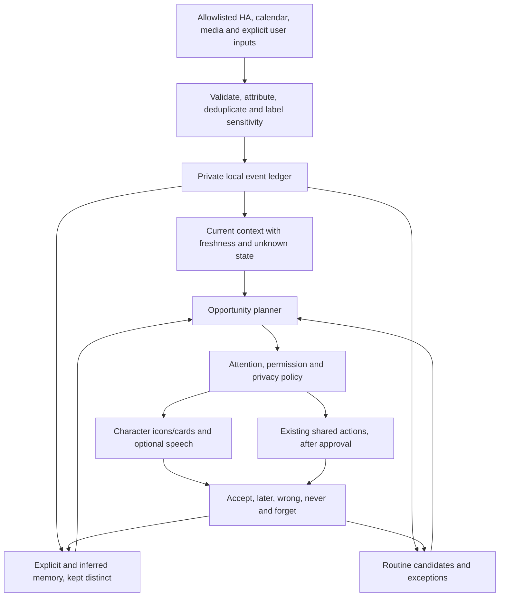

# Amadeus: local proactive companion trial

Status: **private onboarding and explicit memory controls available; live collection disabled**.
Decision date: 2026-10-27. Amadeus is the learning and memory subsystem of
OkabeBot, named in reference to Steins;Gate 0. It is not another character or a
replacement for the existing local conversation and shared action interfaces.

## Trial outcome

Demonstrate that the companion can remember an explicit preference, recognize a
useful recurring context, and offer a grounded suggestion at a welcome moment.
Start with morning/arrival context, evening media choices, and dinner planning.
Learning must remain inspectable, correctable, deletable and local. A successful
trial is useful assistance with few interruptions, not the number of automations.

This document is the product specification. [The trial checklist](amadeus-todo.md)
owns sequencing and acceptance gates. [Deployment inventory](deployment.md) owns
installed state. Source implementation is not evidence of activation.

## Scope and non-goals

Initial scope: a private event ledger, explicit preferences, current-context state,
routine candidates, explainable suggestions, feedback, and bounded approved tools.
The Mac hosts storage and inference; Home Assistant supplies selected events;
the Pi, Mac, phone and TV remain presentation/input destinations. Characters share
personal knowledge but phrase it in their own personalities.

No continuous ambient transcription, camera-based identity, model training,
autonomous purchases, sensitive personal inference, cloud LLM fallback, or new
AWS infrastructure. Alexa conversation parity is paused; its accepted scene/demo
and destination behavior remain separate. Grocery/catalogue connections involve
provider clouds even when personal inference is local.

## Optional supportive habit coaching

Amadeus onboarding must ask whether the user wants help establishing or
reaffirming habits they choose. Offer choose topics, not now, and no. Nothing is
preselected; declining must not cause repeated solicitation. General Amadeus
consent does not authorize coaching. Later changes are available in private controls.

Initial topics are optional movement breaks, winding down/rest, drink breaks and
meal planning. The user chooses their goal, cues and comfortable schedule; no
numeric health target, diet, weight goal or medical plan is inferred. Suggestions
must accommodate the user's stated limitations and preferences. A missed routine
is not a failure or evidence of poor character. Establish/reaffirm and topics are
explicit setup choices; detailed user-defined goals/cues remain a later layer.

Tone is invitational and easy to decline: “Would a short movement break feel good?”
Avoid “you should,” missed-streak warnings, comparisons, food morality, guilt,
punishment and unsolicited body/weight commentary. Character personality may not
turn a health nudge into teasing, coercion or moral judgment. Celebrate only when
welcome; do not infer success from silence or absence of negative feedback.

The offline policy requires explicit per-topic opt-in, confirmed identity,
private surface, available context and an eligible opportunity. Its default
presentation is a quiet card, at most one acknowledged coaching card per local
calendar day with a 60-minute cooldown across midnight. It must also consume the
shared Amadeus interruption budget once delivery is integrated; it does not gain
an additional budget. Planning is side-effect-free; count delivery only on ACK.
No live enforcement or notification delivery is claimed by this offline component.

Explicit helpful/later/not-helpful/stop/topic-off feedback is authoritative.
Later and not-helpful pause coaching for a day; stop disables it. Helpful never
increases frequency, enables speech or adds a topic. Missing feedback does nothing.
The state is private, subject-scoped, durable and removed by subject deletion.

Audio sentiment is a separate deferred research item, disabled by default. If
evaluated, process only the user's intentional response locally, discard raw audio,
represent uncertainty and allow abstention. Separate consent and diverse synthetic
evaluation are required before use. Never label inferred emotion as medical or
mental-health state, infer willingness from a cheerful tone, override explicit
words, or increase nudging from guessed emotion. A cautious future use is to
reduce interruption or ask a neutral feedback question. Emotion recognition has
context/interpretation limitations; see the primary research
[ethics sheet](https://doi.org/10.1162/coli_a_00433).

## Public repository and private trial records

Commit core improvements, synthetic tests, declarative specifications and general
capability/regression notes only. Do not commit trial results, personal examples,
transcripts, health goals, responses, habit observations, schedules, receipt/media
history or derived participant metrics. Do not publish ostensibly anonymized
trial aggregates or paste them into PRs/issues. Synthetic test counts are engineering
verification, not participant outcomes.

Private trial records belong under ignored `.local/`, `amadeus-private/` or
`amadeus-trials/` directories. Known artifact paths are checked by the commit hook,
CI and release audit; this is not a content-based privacy guarantee. Manually review
all public prose and fixtures. Never turn a real record into a fixture by changing
its name. User-approved privacy policy changes may revise this rule later, but
no current consent to publication is assumed.

[The engineering log](amadeus-progress.md) records high-level improvements,
limitations and regressions over time without personal details. Detailed trial
evaluation still happens locally and informs general code fixes; it is not exported.

## Architecture and contracts



Adapters publish facts, never authorize actions or draw UI. Each event has a
stable source/event ID, subject (including `unknown`), kind, observation time,
bounded structured payload, provenance and expiry. Late events are stored as
history, not replayed as current triggers. Source disappearance means unknown,
not away/asleep. Reconnect/backfill must not replay greetings or actions.

The first offline store accepts only explicitly allowlisted source names. It is
not an authenticated ingestion server. Future live adapters must bind source
identity and subject permissions at the controller boundary; a caller-supplied
source string or subject is not authorization.

Planned high-level operations:

| Operation | Contract |
| --- | --- |
| `observe(event)` | Validate/deduplicate an authorized observation; no side effect |
| `remember_preference(subject, key, value)` | Explicit user instruction; authoritative over inference |
| `recall(subject, context)` | Relevant, fresh, disclosure-appropriate evidence only |
| `explain(memory_or_suggestion)` | Sources, age, uncertainty and applicable permissions |
| `forget(subject, item_or_source)` | Remove records plus dependent derived artifacts |
| `propose(context)` | Reviewable candidate with reason, expiry and permission requirement |
| `feedback(proposal, outcome)` | Distinguish acceptance, timing rejection and preference rejection |

The store/CLI and owner-only setup/memory dashboard subset are implemented.
Semantic recall, explanations, observation adapters, planning and voice/MCP memory
tools remain planned. Saving permissions does not activate a source.

## Memory model

Keep explicit preferences, observations, inferred preferences, routines,
commitments and temporary context separate. A watched title is not a positive
rating; a purchase is not consumption; a door opening is not departure. Each
derived memory needs evidence IDs, subject, confidence, last support, expiry,
model/rule version and disclosure scope. Explicit preferences carry their own
user-stated provenance and survive expiry of unrelated observations.

User corrections override inference. Conflicting explicit preferences require a
visible correction/version, not silent resolution by the LLM. Temporary context
expires; learned habits decay. Raw audio is not a memory. Initial storage supports
bounded structured events and explicit JSON-valued preferences, not transcripts,
receipt bodies, embeddings, inferred memories or arbitrary model memory writes.

Recall requires relevance, reliable attribution and utility. Limit injected
memories, show why they were selected, and do not bring unrelated personal facts
into ordinary conversation. All characters use the same subject-scoped store.

## Signals and gaps

| Domain | First signals | Gap / rule |
| --- | --- | --- |
| Morning | Explicit interaction; opt-in alarm/charging and occupancy | Awake is a hypothesis, not a phone-state fact |
| Departure/arrival | Door plus Android/router presence | Require freshness and identity evidence; retain unknown |
| Evening media | Cast title/app/state and explicit ratings | Deduplicate ads/autoplay; completion and liking are distinct |
| Calendar | Existing read-only iCal events | Plan is not attendance; cancelled/changed events invalidate proposals |
| Purchases/delivery | User-selected receipt imports, later chosen notifications | No assumed consumer order-history API; no broad inbox ingestion by default |
| Pantry | Confirmed items, quantities and consumption updates | Estimates cannot become confirmed inventory; expiry is user/product supplied |
| YouTube | Observed sessions; opt-in history export | Public API does not expose watch history; search import is optional and sensitive |

First hardware addition, if needed: one local occupancy sensor near the main
companion, combined with existing phone/door signals. mmWave occupancy does not
identify people. Router presence is supporting evidence, not reliable away proof.
No hardware purchase is required for the offline foundation.

## Routine and opportunity engine

Start with time-window and sequence statistics, separated by weekday/weekend and
calendar context. Do not train a new model. Store support count, observed eligible
days, exceptions, freshness and last change. Do not double-count repeated callbacks.
An inferred probability must be calibrated before displaying it as a percentage.

Proposed cold-start gate: at least five eligible occurrences over seven observed
days before a routine becomes a candidate for review; rare/weekend routines may
need longer. This is an initial heuristic, not a statistical guarantee. Holidays,
travel, guests, outages and schedule changes must be excluded or separately tagged.

An opportunity includes evidence, expected benefit, deadline, intended surface,
sensitivity, action plan and fallback. Policy chooses discard, defer, quiet card,
ask, or execute a specifically preauthorized action. The LLM cannot promote its
own permission. New observational learning starts in shadow mode with no output.

Default active-trial attention budget: two unsolicited suggestions per day,
one per context transition, 60-minute cooldown, quiet hours and focus/movie
suppression. Explicit requests and existing critical alerts are separate. These
are proposed defaults to approve at checkpoint A, not live settings. Ignoring a
card is not negative preference feedback. Suppress duplicate cross-surface offers.

## User stories and reviewable behavior

| Persona / story | Expected behavior | Acceptance |
| --- | --- | --- |
| Busy commuter, earlier appointment | Offer preparation reminder while still useful | Calendar provenance; no false assertion of departure |
| Remote worker, first interaction | Brief agenda only when available, not during focus | Once per morning; dismiss/later honored |
| Returning user | Relevant recap and recall of an explicit dinner request | Supported arrival; no private shared-screen disclosure |
| Weeknight viewer | A few available films fitting time and preferences | Region/subscriptions checked; played is not liked |
| Home cook | Recipe using confirmed food, questions about uncertain stock | Dietary exclusions respected; no invented ingredient quantities |
| Grocery shopper | Local draft with products, quantities, estimates and substitutions | External cart modification requires approval; checkout remains manual |
| Guest/shared household | Generic scene and non-personal notifications | Unknown identity cannot retrieve another person's memory |

Example future flow: confirm morning context → show agenda icon → user requests
briefing → changed appointment informs an optional preparation reminder. Later,
supported arrival recalls an explicit dinner plan → uncertain spinach stock is
confirmed → recipe generates a local missing-ingredients draft → user reviews
before an external cart write. At night, a film recommendation uses the selected
subscriptions and explicit feedback, without interrupting current playback.

## Privacy, security and retention

Source-level controls independently enable observation, retention, inference and
actions. Guest mode, pause learning, per-subject access and per-surface disclosure
are mandatory before live personalized output. A dedicated receipt import or
mailbox is preferable to broad Gmail read scope; label filtering is not OAuth
scope restriction. Third-party text is untrusted data, not tool instructions.

Proposed retention: raw structured events 30 days; routine summaries 90 days since
last support; confirmed preferences until changed/deleted; private exports under
user control. Retention pruning must run on a schedule before live collection;
the offline CLI prunes on each invocation. Subject deletion removes events and
preferences; derived evidence graphs, caches, embeddings and queued proposals
must participate when introduced. Backups need explicit expiry/deletion policy.

Store in a private directory, private DB permissions, encrypted host disk and
encrypted backups. SQLite is not application-level encryption. Offline deletion
removes logical records and uses SQLite secure deletion, but cannot promise
forensic erasure from SSD snapshots or backups. No personal data in public docs,
CI fixtures, logs, provider queries or model training. Public catalogue queries
and external carts disclose selected information to their providers; show that
boundary before enabling them. Network-denied local-only mode is a later gate.

## Trial timeline and human checkpoints

Indicative **14-day trial starting after checkpoint A**, not a promise of
unattended future work. Calendar dates shift with review and data availability.
Implementation can continue on synthetic fixtures while waiting for reviews.

| Window | Deliverable | Human involvement / gate |
| --- | --- | --- |
| Preparation, beginning 2026-10-27 | Spec, backlog, offline foundation, regressions and PR | Review source scope and privacy at A before live collection |
| Days 1–3 | Allowlisted live adapters; timeline, correction/deletion UI; freshness health | A: choose identity, sources, retention, quiet hours, shared-screen rules |
| Days 4–7 | Shadow routine candidates and hypothetical suggestions | B: inspect evidence and wrong assumptions; no unsolicited output yet |
| Days 8–10 | Quiet cards, explicit recall, feedback and interruption controls | C: approve a small suggestion budget; physically review timing/privacy |
| Days 11–14 | Movie shortlist and pantry/recipe/local shopping draft trial | D: confirm subscriptions, dietary constraints, pantry subset and store |
| End of trial | Evidence-based accept/adjust/stop decision | E: usefulness review; enable selected routines only |

Checkpoint A also asks about optional coaching, topics and comfort with delivery;
it does not ask for health history. Checkpoint C reviews wording and snooze/stop
behavior using synthetic examples before optional coaching is activated. Trial
outcomes stay local at every checkpoint; only general engineering changes are public.

External OAuth consent, receipt/history imports, missing hardware signals and
physical UX tests are the other reasons to request help. No need for the user to
participate in routine coding, synthetic evaluations or documentation work.
If seven observed days do not support a habit, extend observation rather than
lowering confidence requirements to meet the timeline.

## Evaluation and release gates

Use synthetic clocked traces before live data: normal day, remote-work day,
holiday, guest, DST/timezone change, duplicate/late event, offline phone, restart,
unknown identity, changed calendar, stale pantry and interrupted action. Replay
must not send audio, cloud writes or hardware actions. Split prediction evaluation
by time, not random events from the same day. Compare to a simple fixed schedule.

Proposed trial targets: zero unauthorized actions or cross-person disclosures;
zero duplicate suggestions on replay/restart; every suggestion explains evidence;
all forget/retention regressions pass; at least 80% of reviewed eligible context
triggers correct; at least 60% of reviewed suggestions useful; no more than two
unwanted unsolicited interruptions in a week. Report sample sizes and uncertainty;
small samples cannot establish general accuracy. Latency and time-to-usefulness
are measured separately from voice synthesis. No outcome is assumed in advance.

## Research and connector feasibility

- [HA person](https://www.home-assistant.io/integrations/person/),
  [Android sensors](https://companion.home-assistant.io/docs/core/sensors/) and
  [local LD2410 occupancy](https://www.home-assistant.io/integrations/ld2410_ble/).
- [YouTube API history limitation](https://developers.google.com/youtube/data/revision_history).
- [TMDB watch providers](https://developer.themoviedb.org/reference/tv-series-watch-providers):
  regional listings, not entitlement; JustWatch attribution required.
- [Kroger public cart operation](https://www.postman.com/kroger/the-kroger-co-s-public-workspace/request/mwiie4o/add-to-cart):
  validate QFC store/account access before promising it; no checkout claim.
- [Instacart shopping-list links](https://docs.instacart.com/developer_platform_api/api/products/create_shopping_list_page):
  candidate Safeway route, subject to local retailer/fulfillment verification.
- [Grocy](https://grocy.info/): optional local pantry backend, not a required service.
- [Gmail scopes](https://developers.google.com/workspace/gmail/api/auth/scopes):
  general read-only scope is mailbox-wide, not confined to a chosen label.

No new provider account, paid resource, store cart, sensor capture or live
learning was enabled to prepare this specification.

## Private setup checkpoint

Open `/amadeus/` on the same origin as the existing dashboard. It reuses remembered
owner access; a new browser needs the existing dashboard setup key/link. Use HTTPS
on an untrusted network. Companion/surface and publish-only tokens are rejected.
Do not share owner access with visitors to let them view the character.

Choose a private profile ID (not a full name), future source permissions, IANA
timezone, quiet hours, observation retention, and optional coaching topics/mode.
Confirmed source choices may be prepared as a private draft; no personal draft is
shipped with the repository. Nothing begins collecting after a save. The page
always reports that collection and live nudges are unavailable in this checkpoint.
Setup collapses after saving and can be reopened with Review private choices.

Explicit preferences use `user.*` keys; saving an existing key corrects it. They
are not inferred facts. Coaching consent uses dedicated controls, not arbitrary
memory keys. Pause/guest choices persist but have no collector to control yet.
Stop/snooze survives unrelated setup edits; only explicit resume or a deliberate
new topic opt-in changes coaching authorization. No voice/sentiment is analyzed.

The recent observations view is capped at 20 records; private export includes all
unexpired events and preferences for the configured profile plus its setup.
Downloaded exports are personal records: keep them local/private and outside Git.
Known export filenames are ignored and blocked by publication/release guards.
Whole-store forgetting removes setup, draft, consent, explicit preferences and
observations, but cannot erase downloaded copies or external backups.

Shorter retention immediately deletes affected observations; longer retention does
not extend existing event deadlines or restore deleted data. Requests prune expiry;
a scheduled retention job remains a prerequisite before continuous collection.
The API adds no public ingestion route. One private profile is supported; changing
its ID requires forgetting existing Amadeus state to avoid silent reassignment.
Equal quiet-hour start/end should mean all-day quiet when future policy is wired.

Engineering verification uses synthetic HTTP/browser fixtures only. Do not write
personal setup choices, screenshots, exports or trial outcomes into public docs.

## Running the offline foundation

From an installed development environment, use a disposable private directory:

```sh
python -m okabebot.amadeus --folder .local/amadeus-demo remember \
  --subject trial-user --key media.subtitles --value true
python -m okabebot.amadeus --folder .local/amadeus-demo --allow-source synthetic observe \
  --source synthetic --external-id demo-door-1 --subject trial-user \
  --kind door --payload '{"state":"open"}'
python -m okabebot.amadeus --folder .local/amadeus-demo recall --subject trial-user
python -m okabebot.amadeus --folder .local/amadeus-demo forget --subject trial-user
```

The CLI creates its directory with mode 0700 and database with mode 0600; existing
non-private paths are rejected. Sources default to none. It has no network,
hardware or LLM integration. Each invocation prunes expired observations; explicit
preferences persist until corrected/forgotten. Recall is recent structured history
and explicit preferences, not semantic or relevance-ranked retrieval. Stable event
IDs deduplicate retries; conflicting payload/subject/timestamp reuse is rejected.
If no source timestamp is supplied, retries retain the first local observation time.
Use fixtures rather than personal imports before checkpoint A. No background task
is installed by these commands. Run `python -m unittest tests.test_amadeus -v` for
isolated persistence, privacy-boundary, retention and CLI checks.
