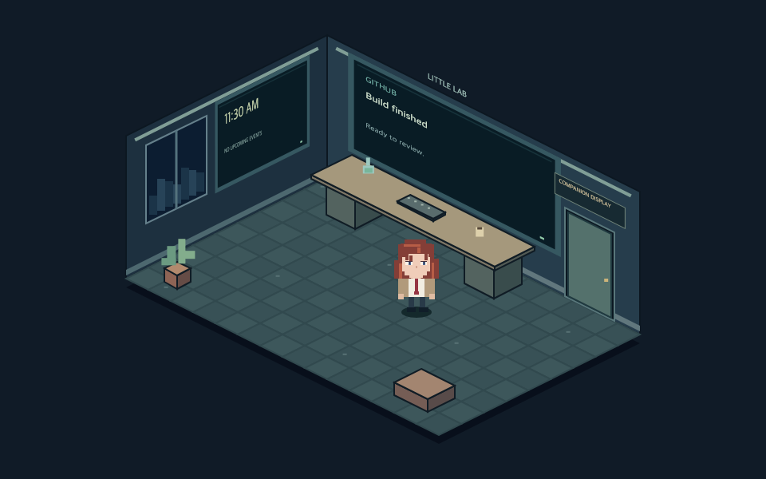

# Companion surfaces: Pi, TV and paired screens

This prototype gives the companion a single location: the Pi shelf display or a
large-screen dashboard. The Mac still hosts the controller and models. The TV
renders a scoped web page; it does not run inference. See the maintained
[deployment inventory](deployment.md) for the installed state.

## Use it

On the ordinary controller dashboard, open **A bigger little lab**:

- **Preview TV dashboard** creates a read-only browser preview. If a browser
  blocks popups, use the revealed **Open TV dashboard preview** link. A preview
  never moves the Pi character and is explicitly labelled.
- **Move to <destination>** replaces the TV's current Cast app with the companion dashboard.
  It is an explicit action; media observation never launches it automatically.
- **Return to <destination>**, or the configured return button on the TV page, returns the companion
  and closes this receiver. This does not resume the previous TV app or movie.

The layout defaults to Cast being left of the Pi. Saved dashboard coordinates
determine direction; `duration_seconds` configures pacing. `travel_side` remains
a compatibility setting for older deployments. The Pi exits toward the other
display. In the TV room, a small full-body companion walks through a doorway,
then follows floor paths to the workbench. Returning walks to the door before
the other display appears. The head reuses the existing character artwork;
compact bodies/connected arms/animated legs are drawn separately. The Pi displays **BE BACK SOON — Taking up more
pixels.** while the companion is away. Normal Pi media/notification overlays are
hidden during travel and restored on return.

The TV view is a cutaway 2.5D pixel lab. Calendar/clock/focus live on a wall monitor;
notifications and deployment status appear on the workbench monitor. Idle movement
uses connected floor anchors, and an active notification draws the character to
the bench. Static room geometry is cached; character motion and monitor updates
are local to the TV browser, without a model call per animation frame. It does not
react to the TV media it has itself replaced. Speech mouth envelopes still mirror
from the controller; network-speaker lip sync remains approximate.

## Named destinations and voice

See [surfaces.json](../examples/surfaces.json) for a mergeable configuration example.
Each destination has a stable `id`, a user-facing `name`, optional voice `aliases`
and an `adapter`. Base configuration supports one `pi` and one `cast` adapter; approved browser/Mac
instances extend that pair through the registry. Those
adapter roles are internal; neither the API nor voice commands require their IDs
or displayed names to be “pi”, “tv”, or “shelf”. Names and aliases must be unique
across destinations. Restart the controller after changing configuration.

`get_companion_locations` exposes the configured list, availability, current
location and pending destination. `move_companion(location_id=...)` requests a
move. The local worker receives the actual IDs as an enum with names/aliases in
the tool description, and validates that the spoken destination matches the chosen
ID. An unknown/ambiguous destination must not become a guessed physical action.
The action remains subject to the existing explicit tool approval allowlist.
For the example above, say “Move to the den display” or “Come to my desk”.
Use your Pi push-to-talk input; a TV remote microphone is not connected to speech
recognition by this feature. Moving the character does not move the Pi microphone. Approved browser/Mac targets can capture their own microphone through the secure-context page; speech output follows the selected location audio destination.

## Remote input: deferred

Physical Vizio testing did not deliver direction/OK events to the Cast page.
Back exited the receiver, but this is not evidence that its buttons reach the
room renderer. The deployed default is `surfaces.remote_controls: false`; use
voice/MCP or the controller's destination buttons. The TV remote microphone is
not connected to the companion's transcription service.

An experimental keyboard/remote path remains behind `remote_controls: true` for
receivers that forward DOM keys. Directions highlight room monitors/doorway,
Enter on the door requests return, and Back/Escape requests return if forwarded.
Preview input cannot move the real character. Only the last supported navigation
key and timestamp are recorded, never arbitrary typed text. No Vizio hardware
support is claimed. Google documents Android TV remote interaction as media
messages, rather than a general promise of D-pad DOM events on all Cast TVs:
[Web Receiver core features](https://developers.google.com/cast/docs/web_receiver/core_features).

## Setup and boundaries

Install the `cast` extra and configure the existing `spotify.source: cast`,
`spotify.cast_host` and `spotify.device_name` connection. This prototype reuses
that receiver connection; it does not yet have an independent Cast discovery
adapter for API-only Spotify deployments. `surfaces.receiver` defaults to
`dashcast`. There is no second receiver-host setting to keep synchronized.

The configured `web.host` and controller port must be reachable from the TV on the
trusted LAN. A loopback-only controller is suitable for a browser preview, not a
separate TV. No public hosting, inbound cloud webhook, new Home Assistant port or
Google Cast developer account is required for this DashCast prototype. DashCast
itself is a third-party Cast receiver; it must be available to the device.
The receiver is explicitly relaunched for every visit, since forced navigation
replaces its original receiver JavaScript. See the
[DashCast integration](https://github.com/AlexxIT/DashCast) and the
[PyChromecast controller](https://github.com/home-assistant-libs/pychromecast/blob/master/pychromecast/controllers/dashcast.py).

The TV receives a temporary surface capability in the URL fragment, not the full
controller credential. It can read curated cards/artwork, send readiness and
movement acknowledgements, and return itself to Pi. It cannot read transcripts,
run hardware tools, change profiles or publish notifications. Preview capabilities
expire after 30 minutes and cannot acknowledge or move the character. Capabilities
are revoked when returning or restarting the controller; create a new preview
rather than reusing an expired link. Keep both kinds of URL private.

## High-level interface

Full-controller authenticated JSON operations:

| Operation | Meaning |
| --- | --- |
| `POST /surfaces/move` with `{"location_id":"configured-id"}` | Move using the discoverable location registry |
| `POST /surfaces/preview` with `{}` | Return a read-only preview URL |
| `POST /surfaces/tv` with `{}` | Open receiver, prepare and move companion to TV |
| `POST /surfaces/return` with `{}` | Return companion to Pi |
| `GET /state` → `surfaces` | Location, transfer phase, receiver readiness and error |

`GET /state` → `surfaces.locations` exposes names/IDs and adapter availability;
`current_location` and `destination_location` use configured IDs. Legacy
`/surfaces/tv` and `/surfaces/return` remain compatibility routes; new callers use
the location interface. The receiver-only `/surfaces/input` accepts bounded
navigation keys for diagnostics and has no general tool permission.

Callers request a location; they do not redraw pixels or schedule individual
animation frames. `Surfaces` owns ownership/acknowledgements, the Pi's `Motion`
owns its local animation, and the TV page owns its rendered entry/exit. The
receiver-only state/assets/heartbeat/ack routes use `X-Surface-Token`; full
operations retain `X-Hardware-Token`. Do not give a TV the full control URL.

## Recovery and validation

The Pi leaves only after TV artwork loads and the page is ready. The TV enters
only after the Pi reports that an away frame was rendered. On return, the TV
acknowledges its fully hidden final frame before the Pi enters. Duplicate/stale
acknowledgements cannot replay movement. A confirmed Cast app exit, standby/input change after active input was observed,
or scoped page-unload event requests return immediately. If the Pi is offline,
its desired return stays pending and retries on reconnection; the controller only
reports arrival after a rendered-home acknowledgement. A page watchdog hides the
TV character when live state stops arriving; a leased Pi command returns it if
the controller or receiver disappears without a confirmed close event. Recovery deliberately includes a short wait so ownership
does not overlap. Only this receiver's matching Cast session is stopped, never a
new app started by the user.

Isolated tests cover direction, lease recovery, idempotence, readiness/render
ordering, scoped HTTP access and fresh receiver launch. Actual receiver loading,
Pi rendered-away/home acknowledgements and a return to Cast Backdrop were verified
on the installed Vizio/Pi pair. Two live simulated button clips reached the expected named destinations through
transcription, local-model tool selection and spoken reply: about 13.7 seconds
for the first turn and 6.5 seconds for the return turn, including speech. These
are observed runs, not latency guarantees. A controlled native receiver quit then
started return within about 0.5 seconds and reached rendered home around 2.7
seconds. Pending return across an unavailable Pi is covered by isolated regression;
a deliberate live Wi-Fi outage was not introduced. Physical review of room art,
gait and entrance timing remains a user acceptance check. Older TV browsers need compatible DOM methods; the live
trial caught and replaced `replaceChildren`.

The initial `surfaces.lab.theme` is `pixel-lab`; its title is configurable.
Arbitrary room layout/theme editors, extra surface adapters and automatic voice-following
are follow-up work. Speech stays on its configured audio route during this prototype; moving
the picture does not silently reroute sound to the TV.

## Paired phone and Mac screens

See [browser surfaces](browser-surfaces.md) for stable URLs, device discovery and
approval, native Mac app, spatial arrangement, HTTPS microphone setup and phone
PiP limitations. These extend the configured Pi/Cast pair with registered browser
instances. Echo Show has a separate APL skill prototype; registration as a spatial destination remains backlog work.

## Visual polish verified 2026-10-26

The cutaway is centered from its projected room bounds, rather than centering the
canvas around an off-center room. Kurisu has a white blouse and red tie between
her jacket panels. The destination plaque shares the door wall's projection;
the stray floor cable was removed. The native Mac web renderer was updated and
a fresh Cast handoff reached the TV. A silent notification passed through the
live inbox/receiver projection and was visually checked in the shared room
preview. This is not a physical TV legibility or long-running reliability test.
Volumes and audio routing were unchanged. See [surface options](surface-options.md)
for research on additional destinations; Alexa has a separate APL prototype; browser/Mac status is documented in the guide above.

## Scene sets and world rules (source preview)

Physical locations and scene sets are separate. Each location has a **Room**
(full cutaway) or **Companion** (compact, transparent scenery) presentation and
one optional set selection per character. The current Pi renderer supports
Companion only. Browser, Mac and Cast renderers support both presentations.

| Character | First set | Second set |
| --- | --- | --- |
| Okabe | Future Gadget Lab | May Queen Café |
| Kurisu | Future Gadget Lab | May Queen Café |
| Pip | Pip’s Workshop | Rooftop Garden |
| Sonic | Green Hill | Star Light |

The catalog is `okabebot/assets/scene-sets.json`. The controller owns assignments
in its private `surface-devices.json`, not in a browser's local preferences.
The dashboard location editor can choose a character independently of the active
character. An occupied set is disabled there; the server also rejects duplicate
claims atomically. Room and Companion do not create separate copies of a set.
Reservations are per character and survive disconnection. Release a selection
with **Unassigned**, or forget a registered device, before reusing its set.

Existing deployments retain legacy scenery until **Set up scene world** is
pressed while the character is home. This explicitly reserves each character's
first catalog set at home in a single transaction; individual assignment edits
are disabled until setup completes. Repeating initialization is rejected rather
than resetting preferences. Assign the second sets to other screens afterward.
Strict rules reject movement or character changes if either the destination or
that character's home has no assignment. Home selections cannot be cleared in
the dashboard API. An occupied character's set cannot change until it moves
elsewhere; assignment edits are blocked during movement. There are only two sets
per character, so additional screens remain unassigned until more sets are added.

These guards prevent routine edits from stranding automatic returns. Hand-edited
or corrupted private state can still create an unassigned home; repair its
assignment before moving again. Such a renderer hides the actor rather than
silently duplicating a set.

Generate the isolated review gallery with
`PYTHONPATH=. python scripts/preview-scene-sets.py`. It contains Room and Companion
views of all eight combinations, with generic preview data. New world rules and
scenery are source changes, not evidence of installation. The active deployment
has not been migrated; the offline Pi still needs deployment and physical review.
Alexa's APL artwork exporter accepts `--set`, but the Show prototype is not yet a
registered spatial destination and does not participate in these reservations.
